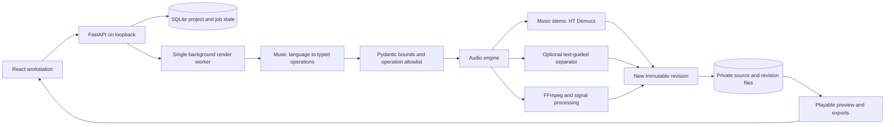

# Reel Studio: design and end-to-end build plan

## Product contract

Reel Studio is a standalone, single-user web audio workstation for short video. A creator uploads
a video or audio file, describes an edit, listens to the result, adjusts it, and exports it. Muse
converts language into validated operations. Specialized audio models and deterministic signal
processing execute those operations. The model never constructs a shell command.

The initial release runs locally. Import, editing, history, and export must work without an
Instagram account. A future mobile companion can hand an exported video to Instagram's Sharing
to Reels flow. Embedding this editor inside Instagram would require a separate platform agreement
or integration surface; publishing APIs are not an embedded editor SDK.

The full scope includes music stem separation, arbitrary sound selection, background cleanup,
clip extraction, timing/pitch edits, rearrangement, looping, music alignment, ducking, mixing,
reversible conversational changes, and audio/video/stem export. Features depend on the installed
engines. An unavailable model must produce an actionable error, never a plausible substitute.

## User journey and acceptance conditions

1. Open the editor and upload a video or audio file, or load the public Drumeo sample.
   The waveform and actual media appear after extraction. Upload errors explain file/size limits.
2. Select a time range by seeking and setting its start/end or entering numeric bounds.
   All ranges refer to the currently selected revision, not the original video.
3. Ask for an edit or use direct controls. For example: "Keep drums at full volume, lower
   everything else 12 dB, then slow seconds 4 through 8 to 0.75x."
4. The app validates a bounded JSON plan, processes it as a background job, and shows progress.
   The current playable revision changes only after every operation succeeds.
5. Listen to original and edited versions, inspect the actual waveform and revision notes,
   undo/redo or select any saved revision, and refine with another command.
6. Upload auxiliary music, pick a video anchor and a music offset, and align a detected beat,
   estimated drop, or exact source offset. Preview and adjust the anchor.
7. Export an MP4 containing the heard mix, a WAV, or available separated stems as a ZIP.
   Exported files must decode completely and preserve the intended duration and timeline mapping.
8. Reload the app. Projects, imported music, history, and successful revisions remain available.

## Architecture

The backend serves the built frontend and media on the same origin. Vite proxies API/media routes
while developing. SQLite stores project documents, revision descriptors, chat turns, and jobs.
Large audio/video assets live in a private data directory, outside the repository. One model job
runs at a time to keep CPU and memory use predictable; each project also rejects conflicting edits.

This is intentionally a local workstation rather than a hosted multi-user service. There is no
account system, billing, public upload URL, or unattended publishing. A public deployment would
require authentication, per-user storage isolation, quotas, a durable process queue, and workers
isolated from the API server before exposing this service beyond loopback.

## Data and revision model

- Project: ID, name, original/current revision IDs, imported music reference, chat and revisions.
- Revision: parent ID, actual duration, validated operations, planner provenance, waveform,
  beat estimates, notes, audio/video URLs, optional separated track URLs, and timeline mapping.
- Job: queued/running/complete/failed, progress, message, project ID and safe error description.
- Original media is normalized once to a consistent audio format. Subsequent revisions use lossless
  WAV audio, avoiding repeated lossy audio decoding. Video previews use H.264/AAC with fast start.
- A failed edit creates no playable revision. The last successful revision remains selected.
- A restart marks unfinished jobs as interrupted. It never marks partial files as successful.
- Editing an earlier revision creates a branch in revision history. Other saved outputs survive.
- Stem exports identify their separation stage. They must not be labelled as the final mixed
  render if later effects or timeline operations were not applied to those individual estimates.

## Supported operations and implementation approach

| Operation | Method | Acceptance condition |
|---|---|---|
| Import/extract | FFprobe validation, FFmpeg decode, stereo lossless working audio | Video and audio-only files load, malformed uploads fail safely |
| Isolate/remove music stem | Meta HT Demucs, four stems | Real estimates, cache hit on repeat, non-silent known fixture |
| Stem mixer | One separation, gains on vocals/drums/bass/other, summation with headroom | Requested relative gains, reproducible render, no clipping |
| Select/remove arbitrary sound | Optional local text-guided model, target and residual | Actual inference required; unavailable setup is explicit |
| Noise reduction | Spectral noise reduction for broad cleanup | Noise estimate reduced on controlled fixture; wanted audio distortion checked |
| Speech enhancement | Optional DeepFilterNet3 with dry/wet strength | Must preserve speech and disclose suppression of non-speech audio |
| Gain | Sample-domain or FFmpeg volume, optional selected range | Measured gain matches requested dB below limiting threshold |
| Speed | Pitch-preserving time stretch; matching video timestamp transform | Audio/video duration agrees with source-to-output mapping |
| Pitch | Pitch shift without changing timeline length | Tone frequency shifts by requested semitones, duration preserved |
| Trim/cut | Slice/reassemble audio and video using the same source intervals | Correct durations and frame/audio mapping |
| Loop/rearrange | Repeat or concatenate selected source intervals | Exact repeat count and deterministic timeline |
| Fades | Sample-accurate ramps | Correct fade boundaries; no unexpected truncation |
| Loudness | FFmpeg EBU R128 loudness normalization | Fresh loudness/peak measurement; quiet material not treated as silence |
| Music fitting/alignment | Onset/beat analysis, estimated energy rise for drop, shift/trim/loop | Selected musical anchor lands on requested video timestamp |
| Ducking | Demucs vocal estimate and sidechain envelope, smoothing and music gain reduction | Music attenuated under estimated vocals, no perfect speech-recognition claim |
| Preview/export | Same revision audio for playback and export | Export equals selected revision, complete decode, correct MIME/download |
| Cinematic ad | Pinned optional Glissade/Skia worker, existing source footage and current mix | Real 15/30 second video, portrait/landscape bounds, safe text, synchronized loop timing, reversible revision |

An estimated drop is not a semantic understanding of a song. A beat detector can choose half or
double tempo and miss syncopation. The UI exposes numeric anchors and preview so users can correct
these estimates. Automatic ducking based on mix activity can react to percussion; voice detection
and a separated voice sidechain are quality improvements to evaluate rather than claims to make.

## Language planning and validation

Muse receives current duration, selected range, available engines, whether music is uploaded, and
recent edit labels. It returns only a typed plan. Valid operations have fixed names and bounded
numeric fields. Unknown fields are rejected. Parameters cannot contain commands or filesystem paths.
No tools, shell, web browsing, writes, reminders, or autonomous delegation are exposed in the Muse
planning invocation. The schema and exact accepted plan are retained privately for reproducibility.

Direct controls bypass language planning but pass through the same validation and renderer. A small
command parser is available when Muse is absent and is labelled as such. A configured Muse failing
does not silently become a different model. Unsupported requests fail clearly and preserve history.

## Research-informed quality strategy

The source inventory and license/weight caveats are in [AUDIO_RESEARCH.md](docs/AUDIO_RESEARCH.md).

1. Start with specialized, reproducible baselines. HT Demucs handles known musical sources;
   a generic text separator must not replace it merely because it accepts more prompts.
2. Run enhancement on the target stream where appropriate. Denoising a full mixed soundtrack
   can remove cymbals, ambience, and breath that the creator wanted to keep.
3. Prefer lossless intermediates; keep float processing headroom and apply explicit peak protection
   before encoding. Never normalize every isolated stem independently before reconstructing a mix.
4. Preserve stereo coherence and duration. Resample at model boundaries, restore the working sample
   rate, and correct inference latency/padding before remixing a residual.
5. Use short preview ranges for iterative heavy model work. Cache separation by audio content,
   model identity and relevant inference settings. A cache hit must not confuse two different edits.
6. Keep model/paper quality claims separate from measured app quality. Published MUSDB SDR scores
   are not results on arbitrary Instagram audio or on this workstation.

## Optimization plan

### Implement first

- One import normalization per file, lossless audio revisions, compressed browser previews.
- Cached four-stem inference reused by isolate/remove and mixer operations.
- Bounded concurrent renders and bounded upload/input/output sizes.
- Streaming uploads and disk-backed ZIP exports instead of full-file memory copies.
- Waveform downsampling for the browser, cached analysis on successful revisions.
- Separate optional heavy model environment from the lean web/API runtime.
- Background progress and immutable outputs so the interface remains usable during CPU processing.

### Benchmark before promoting

- Compare Demucs overlap/shifts settings on transient preservation, source bleed, wall time and memory.
  Current low-cost CPU settings are a latency choice, not an asserted quality optimum.
- Compare CPU, supported MPS and CUDA workers using identical fixtures and exact checkpoint IDs.
- Evaluate a long-lived worker with models loaded once against subprocess startup cost. Adopt it only
  if the gain outweighs memory retention and failure isolation costs.
- Compare RoFormer music models against Demucs using matched licences/checkpoints and test songs.
- Evaluate neural speech cleanup versus spectral denoising on speech, music, wind, crowd and laughter.
- Consider overlap-add chunks, mixed precision or quantization only after checking seams,
  residual consistency, speech intelligibility and target loss on the chosen model.
- Use VAD/separated speech to improve ducking; compare false triggers from drums and other speakers.
- Add multi-anchor constrained music alignment only after single-anchor timing is measured.

## Build sequence and verification checkpoints

### 1. Working media foundation

Create Python/React projects, validate uploads, extract WAV, generate waveforms, produce browser
playback, and save state. Test audio-only input, video input, invalid bytes, empty upload, size and
duration limits, ID/path rejection, and reload persistence. No mocked waveform or fake playback.

### 2. Reversible editing core

Implement gain, spectral cleanup, tempo/pitch, trim/cut/loop, fades and normalization. Use synthetic
signals with known frequencies, noise and event timestamps, plus real video for sync. Require measured
gain, frequency, duration, finite samples, headroom, and decodable video after timing changes.

### 3. Real separation and mixer

Install pinned CPU-compatible Demucs separately, run all four stems on the real Drumeo excerpt,
cache them and expose isolate/remove/mix. Verify stem duration, non-silence, reconstruction error,
and compare audible bleed. Do not hide inference failures behind an original-audio fallback.

### 4. Music fitting and ducking

Upload independent music; expose start/beat/drop alignment and numeric anchor, fit it to the current
video duration, and add smooth sidechain attenuation. Test the exact anchor mapping on an impulse
fixture and attenuation on a controlled activity signal. Include notes explaining estimates.

### 5. Muse-driven conversation

Generate plans through the authenticated Muse CLI, validate them and route through the same engine.
Test compound edits, numeric ranges, references to current selection, music prerequisites, unknown
operations and failed planner runs. Capture at least one real authenticated request and render.

### 6. General sound selection

Evaluate accessible open checkpoints using a dedicated worker. Implement target and residual output
with exact rate/length alignment, validate actual inference, and label model availability honestly.
Test at least overlapping voice/music, background noise with voice, and environmental sounds.
If weights or inference remain blocked, retain a usable optional adapter and report the missing
runtime dependency explicitly; do not report the complete general-sound feature as verified.

### 7. Complete workstation and exports

Connect real playback, waveform selection, per-stem gains, direct effects, natural language, job
errors, revision selection, undo/redo, and MP4/WAV/stem download. Test through the browser with a real
upload and a real edit. Inspect desktop/mobile renders, keyboard focus, overflow and console errors.

### 8. Quality and reproducibility

Run the complete suite and record actual results. Measure known-fixture behavior and use a held-out
set of real recordings before claiming broad quality. Document runtime/model setup, licenses, sample
provenance, constraints, and how to reproduce. Leave an uncommitted verified tree unless asked to ship.

## Evaluation corpus and quality gates

Maintain private fixtures and results, not copyrighted media in source control. Include clean music
stems mixed at known gains, speech mixed with stationary noise, wind/crowd/intermittent noise, drums
with vocals, stereo ambience, silence, clipped input, compressed low-bitrate audio, and videos with
known synchronized transients. Real audio without reference stems requires listening, not invented
SNR or SDR claims. Model-supplied benchmark metrics never replace this evaluation.

Acceptance gates: complete decode; finite non-silent output when expected; no new PCM clipping;
retimed duration within one video frame plus codec padding; pitch/gain/anchor measurements against
known references; atomic revision selection; successful export of the selected revision; accurate
availability and planner labels; errors leave the previous result playable.

## Current integrated implementation

The first complete local implementation now includes the React editor, FastAPI/SQLite backend, Muse planner, float-output HT Demucs worker, text-guided AudioSep worker, and DeepFilterNet3 speech worker. Model setup is pinned and external to the source tree. The known-reference test suite and live API tests are separate evidence: the live path exercised all three models, persisted a music bed, aligned and ducked it, retimed both layers and exported the result.

Added music is stored as a separate dry/music layer pair. Realignment replaces the previous bed; ducking modifies the bed instead of mixing a second copy. Timeline and linear level effects transform both layers. Full-mix cleanup, normalization or separation can flatten that layer pair, which is recorded in the revision notes. Stem downloads remain labelled by their separation stage.

Music beds are placed at sample positions with short crossfades. The final video mux retains complete audio instead of truncating it to a video frame boundary. Tests check exact start anchors, persistent-layer duration and flash/burst synchronization. The frontend was also inspected at a 390 px viewport with full editing controls open.

## Explicit boundaries

Arbitrary separation is probabilistic; it cannot promise perfect removal. Licensed music access,
private Reel downloading, perfect automatic beat/drop recognition, isolating an unspecified person,
and direct Instagram editor embedding are not assumptions the build can make. The upload flow is
the reliable input path. Public-link fetching is a possible later import convenience, with clear
failure handling, rather than a dependency for creating or exporting a project.
