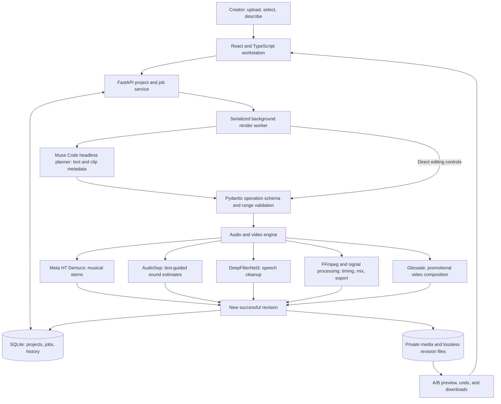

# Reel Studio

**Keep the sound you want. Say what should change.**

A conversational audio editor for short video, built for the **Meta Global AI Developer
Hackathon** by **Laksh Goyal**. Powered by Muse Code for edit planning and Meta HT Demucs
for music separation.

[Watch the demo](https://youtu.be/sXMqsIOS1rs) |
[Architecture](#architecture) |
[Workflow](#how-it-works) |
[Run locally](#run-locally)

## The problem

You hear a Reel and want to make something with its sound. But you only want the drums,
one passage of the song, or the voice without the background noise. Reaching that result
can involve a stem separator, an audio editor, and a video editor before importing it
back into Instagram. A small creative decision becomes a multi-tool production task.

Meta identified the broader friction in its [Edits launch announcement][edits-source]:
creating videos can require multiple apps and complicated workarounds. Adobe and Harris
Poll's [2025 Creators' Toolkit survey][creator-survey] provides wider workflow context:

| Finding | What it informs in Reel Studio |
| --- | --- |
| 60% reported using more than one creative generative AI tool in the previous three months | Bring sound selection, cleanup, timing, and export into one workflow |
| 51% identified automating repetitive tasks as a desired agentic-AI use case | Let creators describe an outcome instead of repeating tool setup |
| 34% cited unreliable output quality as an AI-adoption barrier | Make the result audible, comparable, and reversible |

The survey covered over 16,000 creators across eight countries in September 2025 and
focused on emerging and semi-professional creators. These are findings about creative AI
generally, not measurements of Instagram audio-editing demand or Reel Studio's time savings.

## What it does

Upload a clip, describe the change, hear the rendered result, and refine it.

| Creator request | Working capability |
| --- | --- |
| "Keep only the drums." | Separate music into vocals, drums, bass, and other; isolate, remove, or mix stems |
| "Clean up the voice." | Apply speech denoising with adjustable strength |
| "Keep this sound." | Estimate a named target and residual with optional text-guided separation |
| "Slow seconds four through eight to 0.75x." | Change the selected section's speed while preserving pitch and retiming video |
| "Make this beat land at four seconds." | Align uploaded music to a chosen video anchor, with numeric correction |
| "Turn this into a 15-second promo." | Compose existing footage and edited audio with animated titles and a call to action |

Creators can compare original and edited audio, undo, restore an earlier revision, and
export MP4, WAV, or available stems. Separation and beat detection are estimates; preview
and direct controls let the creator correct the result.

## How it works

1. **Import:** Upload video or audio. FFmpeg extracts the working audio; the app displays
   the actual waveform and stores the original outside the source tree.
2. **Describe:** Select a range and give an instruction. Muse receives the request, clip
   duration, selection, installed capabilities, music availability, and recent edit labels.
3. **Plan and validate:** Muse returns a structured operation list. Pydantic and backend
   checks reject unsupported operations and invalid parameters before rendering.
4. **Render:** A background worker runs the required audio model or media operation. Timing
   edits apply corresponding changes to the video. Working audio stays lossless between revisions.
5. **Compare and refine:** A successful job creates a new revision. A/B preview, undo, and
   history preserve creative control; a failed edit leaves the previous playable revision intact.
6. **Export:** Download the selected result and import it into your preferred publishing workflow.

For example, "Keep drums at full level, lower the other stems by 12 dB, then slow seconds
four through eight to 0.75x" becomes a stem-mix operation followed by a selected-range
speed operation. Later operations refer to the timeline produced by the earlier ones.

## Architecture



Audio workers run locally after setup. In this implementation, Muse receives text and
clip metadata rather than the raw media. Its planning invocation disables shell, write,
and web tools. Direct controls and language-generated plans share the same validation
and rendering path. [See the full design](DESIGN.md) for state, failure handling, and limits.

## Why Meta and Muse

[Muse Code][muse-docs] is Meta's coding agent for the terminal and CI. We use its headless
automation surface inside the app as an edit planner: creator language goes in, a bounded
JSON operation list comes out. Structured output and existing model access let us connect
that intent to a media engine without asking the model to execute arbitrary code.

[Meta HT Demucs][demucs-source] contributes the actual music source estimates. A mixed
soundtrack becomes four editable components, which makes requests such as "keep the drums"
possible. The same estimates support stem mixing, downloads, and a vocal sidechain for music
ducking. Muse plans the edit; Demucs and the other workers perform audio processing.

This combination is the central product opportunity: pair a language interface with editable
sound inside a creation flow that creators already know. Edits already brings video tools
together. Reel Studio explores a conversational audio-editing step for Reels or Edits.
**The submitted app is standalone and exports files for manual import. Native integration
is a proposed next step.**

## Original audio, attribution, and permitted use

We reviewed Instagram's official audio guidance and Meta's Music Guidelines on November 4, 2026.
The proposed product extends an existing creation flow: [Edits already supports reusing audio
from public Reels][edits-reuse]. The contribution is conversational source editing and refinement.

- **Original audio is a platform label, not a blanket copyright clearance.** Instagram describes
  it as unique audio recorded or uploaded by a creator, or another Reels creator's audio. Public
  Reels support in-platform reuse. If licensed music is detected in an upload, Instagram may
  change attribution to the artist and song. [Original-audio guidance][original-audio]
- **Licensed audio retains attribution and usage limits.** Instagram requires artist/track
  attribution for licensed audio. Its ordinary music library is intended for personal,
  non-commercial use, with account, post-type, and regional restrictions. Meta's Music Guidelines
  require appropriate licenses for commercial or non-personal music use. [Library access][music-library]
  and [Music Guidelines][music-guidelines]
- **Export is a separate consideration.** The Edits help page says licensed audio over 60 seconds
  in a video is excluded from its download. That platform rule does not establish permission
  for arbitrary stem extraction, transformations, or off-platform redistribution. Our design
  requires clearance for the intended edit and destination. [Edits audio guidance][edits-audio]
- **Ad studio needs commercially cleared audio.** Use audio whose relevant rights the creator
  controls, appropriately licensed material, or eligible Sound Collection assets under their terms.
  A song being available in the ordinary library does not establish clearance for an ad.

**Current implementation:** Reel Studio accepts user-supplied media and renders local edits.
It does not verify ownership, query Meta's licensing systems, preserve platform audio IDs, or
enforce Instagram's reuse permissions. Use material you own or have permission to edit and use.

**Proposed native implementation:** Preserve the source audio ID and creator/artist attribution
through the edit history. Check the permitted source, account, territory, transformations, and
publishing/export destination before enabling an operation. Treat speed changes and separated
stems as derivatives of the source, rather than granting them new rights or relabelling them as
user-owned audio. Keep catalog audio within authorized workflows; do not offer restricted stems
as unrestricted downloads. Attribution and permission enforcement would require a real Meta
integration and rights-holder clearance where applicable.

## Stack

| Layer | Technology and role |
| --- | --- |
| Interface | React, TypeScript, Vite, waveform and revision controls |
| Service and state | Python, FastAPI, SQLite, serialized background jobs |
| Language planning | Muse Code headless execution and structured output |
| Plan contract | Pydantic operation schemas and local parameter validation |
| Music separation | Meta HT Demucs |
| Optional audio workers | AudioSep for target sounds; DeepFilterNet3 for speech |
| Media processing | FFmpeg, NumPy, SciPy, librosa, soundfile |
| Ad composition | Glissade and its headless Skia renderer |

## Challenges, lessons, and constructive feedback

- **Connecting schemas to Muse:** Pydantic's full JSON Schema needed adaptation for the
  provider's accepted subset. Our adapter inlines references, maps `const` to `enum`, and
  translates `oneOf` to `anyOf`; the complete local schema still validates the returned plan.
  A versioned supported-keyword table and a worked Pydantic example would reduce this
  integration work. Field-level schema errors would make debugging more direct.
- **Keeping audio and video together:** Speed, cut, loop, and reorder operations transform
  both timelines. Validation includes a known flash/tone fixture after retiming.
- **Making AI output reviewable:** A completed model call is not proof of a useful edit.
  The app renders the actual media, preserves the previous successful revision on failure,
  and exposes original-versus-edited comparison and undo.
- **Separating model roles:** Music separation, speech denoising, and general sound selection
  need different workers. Desired sounds can be damaged or unwanted sounds retained.
  Capabilities and revision notes expose those limits instead of silently substituting an engine.
- **Working toward production:** Local processing and serialized jobs make the prototype
  inspectable, but broader creator listening tests and lower processing latency remain priorities.

Muse's headless and structured-output foundation made the language-to-edit integration practical.
Meta's open music-separation research supplied a capability users can hear and manipulate.
The feedback above comes from the integration we built, rather than an unmeasured comparison
with competing models.

## Built during the hackathon

Laksh Goyal built the editing workstation, project and job backend, Muse planner and schema
adapter, model-worker integrations, synchronized timeline operations, reversible revision history,
preview and export workflow, and ad compositor integration.

Demucs, AudioSep, DeepFilterNet, FFmpeg, and Glissade are existing upstream projects. We integrated
them; we did not train or author those models and rendering engines. Research and license links
are in the [audio research inventory](docs/AUDIO_RESEARCH.md).

## What's next

- Test whether creators can independently complete useful edits and judge the exported sound.
- Reduce wait time through measured worker and caching improvements, with quality checks.
- Evaluate native Reels or Edits integration with Meta, rather than treating publishing APIs as
  an embedded editor SDK.
- Move from an invited pilot to production accounts, durable jobs, quotas, and isolated workers.

## Evidence and sources

- [Meta: Introducing Edits, April 22, 2025][edits-source]. Supports the broader multi-app
  workflow problem and the proposed product fit.
- [Adobe and Harris Poll: Creators' Toolkit Report, October 28, 2025][creator-survey]. Survey
  conducted in September 2025; see methodology and scope above.
- [Meta: Muse Code documentation][muse-docs]. Defines the coding agent and its headless surface.
- [Meta: Demucs research and source][demucs-source]. Defines music separation and upstream models.
- [Instagram: original audio and attribution][original-audio], [licensed-library access][music-library],
  [Edits audio reuse][edits-reuse], and [Edits audio and export limits][edits-audio].
- [Meta: Music Guidelines][music-guidelines]. Relevant to music use, commercial content, and restrictions.

[edits-source]: https://about.fb.com/news/2025/04/introducing-edits-streamlined-video-creation-app/
[creator-survey]: https://news.adobe.com/news/2025/10/adobe-max-2025-creators-survey
[muse-docs]: https://dev.meta.ai/docs/muse-code
[demucs-source]: https://github.com/facebookresearch/demucs
[original-audio]: https://help.instagram.com/329208821595430
[music-library]: https://help.instagram.com/402084904469945
[edits-reuse]: https://help.instagram.com/981864247296259/
[edits-audio]: https://help.instagram.com/1718255785758961/
[music-guidelines]: https://www.facebook.com/legal/music_guidelines

## Run locally

Requirements: Python 3.12, [uv](https://docs.astral.sh/uv/), Node.js 22+, and FFmpeg/FFprobe on PATH.
The optional general-sound worker also uses Python 3.11. Models run on CPU by default.

From this directory:

```sh
uv sync --python 3.12
cd frontend
npm ci
npm run build
cd ..
python3 scripts/setup_models.py
export REEL_DEMUCS_PYTHON="$HOME/.codex/work/reel-studio/models/demucs/bin/python"
python3 scripts/dev.py
```

Open [127.0.0.1:8787](http://127.0.0.1:8787). The default server binds to loopback. For an invited
pilot, use a separate data directory and the browser workspace access gate described in
[deployment preparation](docs/DEPLOYMENT.md). It is a pilot gate, not a production account system
or a durable cloud job service.

Music stems can also run through a pinned `uv` worker on first request if no dedicated Demucs
interpreter is configured. The explicit setup above installs dependencies and downloads weights
before editing. No cloud audio inference or paid provider is required for the installed workers.

## Enable Muse conversation

Use an installed, signed-in Muse CLI:

```sh
export REEL_MUSE_BIN="$(command -v muse)"
python3 scripts/dev.py
```

If Muse lives elsewhere, set `REEL_MUSE_BIN` to its executable. The app uses your existing Muse
authorization and model credits. It never reads or displays credential files. A planning call has
shell, writes, web tools, reminders, and delegation disabled. Model output passes through a fixed
operation schema with local numeric/range validation before processing.

Without Muse, direct controls still work. A labelled command parser handles a few simple requests,
such as "isolate drums". It is not presented as a general language model. Configured Muse failures
remain visible rather than silently falling back to a different model.

Examples:

- "Keep drums at their original level and lower vocals, bass and other by 12 dB. Then slow seconds
  4 through 8 to 0.75x without changing pitch."
- "Remove the vocals."
- "Cut seconds 2 through 4, then add a half-second fade at the end."
- "Move this selected section to the beginning."
- "Line up the first detected beat after music time 2 seconds with video time 4 seconds."

## General sound selection

AudioSep is an optional local, text-guided separator for targets beyond vocals/drums/bass/other.
Its isolated worker needs a public checkpoint of approximately 960 MB, plus Python packages and
tokenizer/config assets. The setup verifies the pinned checkpoint and model state before marking
the worker ready:

```sh
python3 scripts/setup_semantic.py
```

The script prints environment variables for the runtime it installed. Set those in the shell used
to launch the app if you choose a non-default location. Inference runs offline after setup.
The model estimates a mono target and duplicates it across the working channels; target stereo
imaging is lost. It can retain unwanted sounds or suppress wanted sounds. Target plus residual
reconstruction is an engineering check, not evidence of perceptual separation quality.

Meta SAM Audio is researched as an alternative, not silently substituted or claimed to be running.
Its official weights/access and deployment conditions are separate from this installed AudioSep
worker. See the [research inventory](docs/AUDIO_RESEARCH.md) for papers, repos, and license caveats.

## Speech denoising

```sh
python3 scripts/setup_speech.py
```

This optional worker uses DeepFilterNet3 from the official v0.5.6 release. It downloads an approximately 8 MB model plus an isolated Python runtime and packages, then verifies real inference. Use **Clean speech** in More tools, or ask Muse for speech-focused denoising. It processes channels independently and preserves timing. It is trained for speech; desired music, laughter and ambience may be suppressed. The broad **Clean up audio** action remains spectral cleanup.

## Workstation features

- Video/audio import and audio extraction, actual waveforms, beat estimates, numeric time selection.
- Musical stem isolation/removal and four-stem gain mixing with Meta HT Demucs.
- Optional text-guided target and residual estimates with AudioSep.
- Spectral noise reduction, optional DeepFilterNet3 speech denoising, selected-range gain, loudness normalization and fades.
- Pitch-preserving speed changes, independent pitch shifts, trim, cut, loop, reorder and audio replacement.
- Uploaded music alignment by exact source point, estimated beat or estimated energy rise.
  Music retains its lead-in when feasible and fills the clip with short loop crossfades.
- Added-music ducking using a Demucs vocal estimate as the sidechain, not perfect speech detection.
- A/B preview, persistent history, undo/redo, and failed-edit preservation of the current revision.
- MP4 and WAV export; separated layers can be downloaded individually or in a ZIP.
- Ad studio: 15 or 30 second portrait/landscape cuts from the current footage and audio, with
  animated titles, a camera push, and a brand/call-to-action close.

Edits execute sequentially. Times for a later operation refer to the output of the preceding one.
Video follows timing edits. Unchanged video bitstreams are copied during audio-only edits, avoiding
an unnecessary new video encode. Working audio stays lossless between revisions.

Stem downloads identify their separation stage. Later full-mix processing can differ from those
individual files; read the revision notes. The current rendered WAV/MP4 is the authoritative preview. Added music is stored separately, so realigning it replaces the bed and ducking modifies that bed without adding another copy. Timing edits transform both layers together. Full-mix separation, cleaning or normalization can flatten layers; the revision notes say when that happens.
Beat/drop detection and sound selection are estimates, with numeric controls for correction.

## Cinematic ad cuts

Install the optional local compositor:

```sh
sh scripts/setup_ads.sh
```

The setup pins [Glissade](https://github.com/tyevco/glissade) 0.79.0, an Apache-2.0 TypeScript
motion-graphics engine with a headless Skia renderer. It downloads IBM Plex Sans under the OFL,
retains its license, and runs a real smoke render before enabling the feature. The runtime and font
live outside this repository. Glissade is an experimental dependency; the version is pinned and
checked locally rather than treated as a mature hosted service.

Open a video, select **Ad studio**, and enter a headline, optional supporting line, brand, and
call to action. Choose 9:16 or 16:9, 15 or 30 seconds, and an accent. **Create cinematic cut** saves
a new revision that can be compared, undone, edited further, and exported through the normal flow.
It composes existing footage. It does not generate new scenes or require video-generation credits.
Short source material repeats to fill the selected length; inspect the rendered loop and revision
notes before exporting. Audio-only projects cannot create a video ad.

Muse can also plan an ad when the renderer is installed and the request supplies the headline,
brand, and call to action. Missing copy prompts a question instead of inventing a product claim.

[OpenScreen](https://github.com/getopenscreen/openscreen) is a useful MIT-licensed tool for polished
product recordings. [Revideo](https://github.com/midrender/revideo) is an MIT alternative compositor.
[Cua Launchpad](https://github.com/trycua/launchpad) supplies launch-video templates, but its
Remotion dependency has separate license terms from the template repository.

## Sample clip

The demonstration uses seconds 30-42 of the [public Drumeo / Chad Smith Reel](https://www.instagram.com/reel/C-LQOCqvX-I/).
Media is not included in this source tree. To prepare the sample locally:

```sh
python3 scripts/setup_demo.py
```

This needs `yt-dlp` on PATH. If a sample file is already available, use
`python3 scripts/setup_demo.py --source /absolute/path/to/clip.mp4`. Uploading your own file is the
primary import path and does not require Instagram login or public-link downloading.

## Storage and limits

Project data defaults to `~/.codex/work/reel-studio/data`, including SQLite documents, originals,
lossless revisions, model output caches and exports. Override with `REEL_DATA_DIR`. All revisions
are retained until you remove the corresponding local project data. Media and credentials should
never be committed. Uploaded filenames are display names, not trusted paths.

Input limits are 250 MB and 300 seconds per file. A rendered revision is limited to 20 minutes.
Heavy processing is serialized. The interface reports queued/running/failed jobs and preserves the
previous playable revision on failure. Restarting the server marks unfinished jobs interrupted.

## Verify

```sh
uv run pytest -q
cd frontend
npm run build
```

Tests use real FFmpeg processing of known synthetic fixtures. They cover import/export through HTTP,
failure preservation, state recovery, rejected plans, range operations, pitch/frequency behavior,
noise reduction against a clean reference, and a synchronized flash/tone after retiming. Model
inference and browser checks are separate integration evidence; unit tests do not establish general
separation quality. Paper benchmark numbers are not measurements of this app.

Read [DESIGN.md](DESIGN.md) for the elaborate architecture, build sequence, acceptance criteria,
optimization experiments, quality gates and deployment boundaries.

## License

Reel Studio's original application code is available under the [MIT License](LICENSE).
Third-party libraries, models, checkpoints, and media retain their own licenses and terms;
see the research inventory for the model and rendering dependencies.
